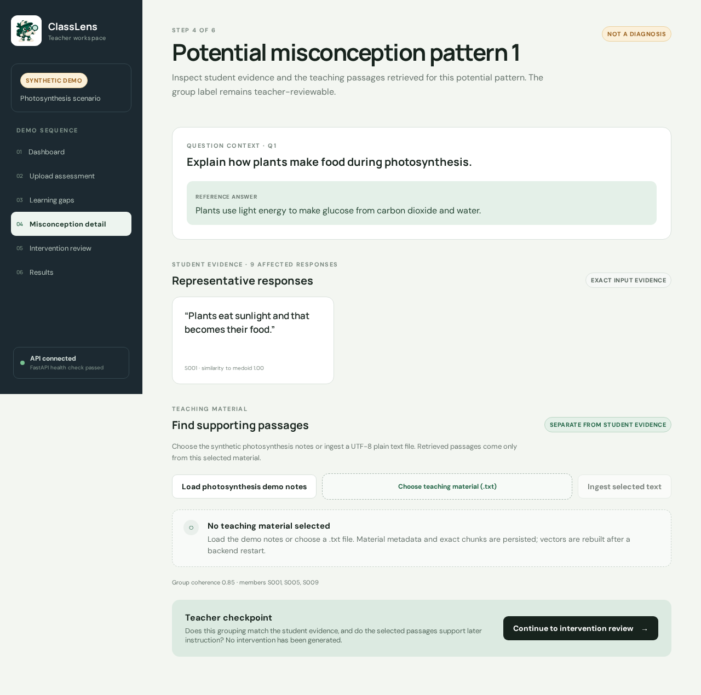

# ClassLens

**From grades to understanding.**

ClassLens is an AI-powered education hackathon MVP for finding recurring, evidence-backed misconceptions in free-text responses, grounding a remediation in teacher-provided material, preserving teacher approval, and comparing understanding before and after the intervention.

The local Grade 7 photosynthesis workflow is implemented:

1. Validate a synthetic or teacher-uploaded assessment CSV.
2. Group recurring incorrect-answer patterns with local embeddings.
3. Inspect exact student evidence.
4. Retrieve passages from teacher-provided material.
5. Generate a source-locked Gemini remediation.
6. Edit and explicitly approve or reject it.
7. Re-analyze a follow-up assessment and show transparent before/after results.

Semantic grouping is evidence for teacher review, not a diagnosis. Before/after results describe observed change, not causal proof.

## Release status

This is a runnable research/demo MVP. Use synthetic inputs only: authentication,
record ownership checks, privacy/retention workflows, and generation spend controls
are not implemented. Hosted analysis remains unverified because the current
backend memory limit is too small for embeddings. See [security boundaries](SECURITY.md).



*Screenshot: synthetic contract-fixture browser run, not live AI output. The
browser smoke uses a reduced one-group fixture; the real baseline has four groups.*

## Local demo

Prerequisites: Linux or WSL, Git, Node 22 (`frontend/.nvmrc`), Python 3.11,
PostgreSQL 17 plus `psql`, and the runner utilities `curl`, `setsid`, and `ss`.
The measured backend peak is about 1.11 GB RSS; allow at least 2 GB of available
memory for the backend, plus capacity for the frontend and database. The initial
model download needs internet access and local cache space.

```bash
git clone https://github.com/rayubaldo44/classlens.git
cd classlens
```

Follow [backend setup](backend/README.md) to install locked CPU dependencies,
configure your own Gemini key and database, and apply **both** migrations.
Then install the frontend:

```bash
cd frontend
npm ci
cd ..
```

The verified backend runtime is Python 3.11. Complete the one-time backend setup and migration in [backend/README.md](backend/README.md), keep `GEMINI_API_KEY` and `SUPABASE_DB_URL` only in ignored `backend/.env`, and install frontend dependencies under `frontend/`.

From the repository root:

~~~bash
./scripts/demo.sh check
./scripts/demo.sh reset
~~~

Open http://127.0.0.1:5173, then follow [the demo guide](docs/DEMO.md). Reset stops only processes owned by the runner; PostgreSQL workflow records are preserved.

Useful commands:

~~~bash
./scripts/demo.sh status
./scripts/demo.sh stop
~~~

If a default port is occupied, choose another explicitly:

~~~bash
CLASSLENS_FRONTEND_PORT=4179 ./scripts/demo.sh reset
~~~

The runner validates Python 3.11 dependencies, frontend dependencies, required fixtures, the server-side Gemini key, port availability, and HTTP readiness. It does not print secrets, delete fixtures, or modify environment files.

## Technology

| Area | Current implementation |
|---|---|
| Frontend | React 19, TypeScript, Vite 8 |
| Backend | Python 3.11, FastAPI, Uvicorn |
| Embeddings | Local sentence-transformers/paraphrase-multilingual-MiniLM-L12-v2 |
| Grouping | Deterministic complete-link cosine clustering |
| Retrieval | Persistent UTF-8 chunks with a rebuildable exact-cosine vector cache |
| Remediation | Gemini gemini-3.1-flash-lite with structured validation and one bounded transient retry |
| State | PostgreSQL repositories; material vectors are a rebuildable process cache |
| Database | Supabase PostgreSQL migration, adapters, integration test, and restart recovery live-verified |
| Deployment | Vercel frontend and Render backend provisioned; hosted cross-origin workflow verification pending |

## Code knowledge graph

Graphify is optional developer tooling. Install the pinned official package separately from the application dependencies:

~~~bash
uv tool install graphifyy==0.9.77
graphify --version
~~~

The official project skill is committed at `.agents/skills/graphify/`. To regenerate it with this release, run `graphify install --platform agents --project` and review the diff. Use the `agents` platform: the `codex` installer in 0.9.77 also creates a hook. Keep the bounded Graphify guidance in `AGENTS.md` and the required start-of-task document reads.

For an optional existing Obsidian vault, save a dedicated destination in the ignored local config (replace the example path and review any existing value before replacing it):

~~~bash
printf '%s\n' '/absolute/path/to/your-vault/Projects/ClassLens/Graphify' > .graphify-obsidian-dir
~~~

Alternatively, set `CLASSLENS_OBSIDIAN_GRAPH_DIR` to an absolute dedicated `Graphify` leaf inside an existing Obsidian vault. The environment value takes precedence over the first non-empty config-file line. Without either setting, output goes to `graphify-out/obsidian`. An unavailable external parent produces a local fallback and a nonzero exit; create/open the intended vault before retrying. External Canvas paths are rewritten and checked relative to the containing vault root, so open the existing `Vault-EN` vault rather than treating the generated folder as a new vault.

Run from the repository root:

~~~bash
./scripts/graphify.sh build
./scripts/graphify.sh update
./scripts/graphify.sh check
./scripts/graphify.sh query "what connects assessment intake to misconception analysis?"
~~~

`build` and `update` first move prior graph inputs/cache into an ignored, recoverable `graphify-out/recovery/before-rebuild-*/` archive; existing visuals stay available. Both extract code from a clean baseline, validate the complete graph, run `cluster-only . --no-label`, validate again, repair the report's refresh guidance, and export the visuals. `update` additionally passes `--force`. Archiving is necessary because even 0.9.77's `extract . --code-only --force` preserves old document nodes when an existing graph is present. If a rebuild fails, exports do not run and the archive remains available for inspection/recovery. Repeated rebuilds retain archives; move old recovery folders to trash when no longer needed. Refresh after source changes; there are no hooks or watchers. Inspect unexpected count changes. Query results provide source context to verify against code, and broad questions can exceed the default output budget.

Open `graphify-out/graph.html` in a browser for the interactive graph. `graphify-out/GRAPH_REPORT.md` provides counts and community navigation; `graphify-out/graph.json` backs queries. In Obsidian, open `02_Projects/ClassLens/Graphify/graph.canvas` for the generated Canvas and follow its symbol notes. These outputs and `.graphify-obsidian-dir` are ignored; the wrapper, exclusions, tests, skill, and instructions are committed.

Extraction uses `--code-only` and no LLM. `.graphifyignore` excludes documentation, environment files, demo/evaluation content, dependencies, caches, worktrees, and generated artifacts. The wrapper rejects symlinks anywhere inside generated destinations before upstream writers. `scripts/graphify_validate.py` checks every node/link/hyperedge source—including Graphify's top-level and nested hyperedge representations—against existing repository files, Git exclusions, `.graphifyignore`, and ClassLens's Python/TypeScript/JavaScript/shell/SQL/JSON code/config allowlist. Source-empty nodes are allowed only as explicit AST or external-import reference stubs with validated incident code edges; missing, isolated, or ambiguous provenance fails. Graphify Cloud, MCP, semantic providers, hooks, and watch mode are not configured. Community names remain `Community N`. The current installation lacks the optional SQL parser, so the migration is not extracted. The pinned release omits advertised graph schema/version fields; `check` validates CLI/skill version `0.9.77`, NetworkX-style graph/nodes/links shape, non-empty nodes, `built_at_commit`, and this source boundary. It does not prove graph freshness; compare that commit with source changes.

To uninstall the isolated CLI, run `uv tool uninstall graphifyy`. To remove this repository integration, make a reviewed change removing `.agents/skills/graphify/`, the Graphify section in `AGENTS.md`, `.graphifyignore`, `scripts/graphify.sh`, `scripts/graphify_validate.py`, `scripts/tests/graphify_test.sh`, and the two Graphify `.gitignore` entries. Move the ignored local config/output and dedicated external `Graphify/` folder to trash if no longer wanted, and remove the dashboard link; preserve the parent ClassLens notes and vault settings. Avoid the upstream broad `graphify uninstall --purge`, which also removes other detected platform integrations.

## Verified demo result

The deterministic follow-up fixture produces:

- before: 9 of 43 answered students affected (20.9%);
- after: 3 of 43 affected (7.0%);
- observed reduction: 13.9 percentage points;
- transitions: 5 resolved correctly, 1 changed but remained incorrect, and 3 still struggled;
- missing follow-up: 1 blank and 1 absent student.

These values are calculated from the parsed assessment data and follow-up analysis, not hardcoded in the UI.

## Repository map

~~~text
classlens/
├── frontend/             # Connected React teacher workflow
├── backend/              # FastAPI services, providers, schemas, and tests
├── data/demo/            # Versioned synthetic assessment/material fixtures
├── scripts/demo.sh       # Safe local check/start/reset/status/stop runner
├── scripts/graphify.sh   # Pinned local code graph, query, and Obsidian export
├── .graphifyignore       # Graph extraction exclusions
├── database/migrations/  # Reproducible golden-path PostgreSQL schema
├── docs/                 # Product, architecture, API, AI, data, and demo guides
├── STATUS.md             # Current verified state
└── TASKS.md              # Remaining prioritized work
~~~

## Verification

GitHub Actions runs these checks on pushes and pull requests. PostgreSQL integration runs in a separate job against an ephemeral database after applying the repository migration.

~~~bash
cd backend
.venv/bin/python -m pytest -q --ignore=tests/test_postgres_integration.py

cd ../frontend
npm test
npm run lint
npm run build
~~~

The opt-in local PostgreSQL test remains available with `CLASSLENS_TEST_DATABASE_URL` configured:

~~~bash
cd backend
CLASSLENS_TEST_DATABASE_URL=postgresql://... .venv/bin/python -m pytest -q tests/test_postgres_integration.py
~~~

Run the deterministic browser smoke after installing Playwright Chromium once:

~~~bash
cd frontend
npx playwright install chromium
npm run test:e2e
~~~

The browser smoke intercepts API calls with contract-valid fixtures. It exercises the complete UI workflow and recovery behavior without contacting Gemini, Supabase, or Render.

For exact current readiness and limitations, read [STATUS.md](STATUS.md). The authoritative product and technical documents are linked from [AGENTS.md](AGENTS.md).

## Contributing and license

See [CONTRIBUTING.md](CONTRIBUTING.md) for development checks and contribution
expectations, and [SECURITY.md](SECURITY.md) for private vulnerability reporting.
Original ClassLens code, documentation, synthetic fixtures, and original images
are [MIT licensed](LICENSE). Third-party material retains its own terms; see
[THIRD_PARTY_NOTICES.md](THIRD_PARTY_NOTICES.md).

Automated tests use synthetic inputs and no hosted credentials. The live demo
needs your own Gemini account/key and dedicated PostgreSQL database; provider
charges may apply. The pinned embedding model downloads from Hugging Face.
Our license does not grant model weights or provider service rights.
