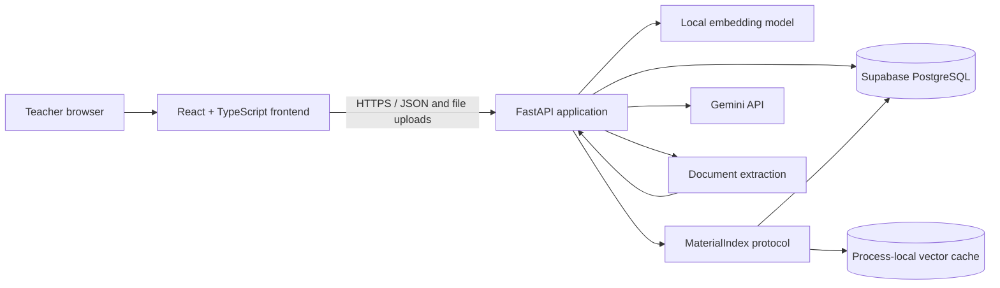

# Architecture

This document defines system boundaries and data flow. The detailed AI algorithms belong in [AI_PIPELINE.md](AI_PIPELINE.md), database fields in [DATABASE.md](DATABASE.md), and endpoint payloads in [API.md](API.md). The React/FastAPI boundary, Supabase PostgreSQL repositories, and restart recovery were live-verified on 2026-10-02.

## Interactive repository diagrams

Generated with Archify on 2026-10-06 from committed revision `5fb327fd05973018c5dc3debb5c5dc826ccddd82`:

- [System architecture](../backend/.archify/architecture-classlens-20261006-095348/classlens-architecture.html) — browser, API, workflow services, local embeddings, Gemini, PostgreSQL adapters, durable records and ephemeral material vectors.
- [Assessment-to-results data flow](../backend/.archify/dataflow-classlens-20261006-095348/classlens-dataflow.html) — baseline intake, evidence, teacher-material retrieval, draft review and approval-gated follow-up comparison.

Both standalone HTML artifacts contain source links, explanatory notes, light/dark themes and export controls. Their finalization receipts passed showcase validation, strict artifact/provenance checks and real Chromium browser checks with no diagnostics. Light/dark screenshots were captured at 1440×900 and 2048×1320; manual inspection covered architecture at 1440 light/2048 dark and data flow at 1440 light/dark. The architecture uses vertical page scrolling at the smaller viewport.

Evidence is pinned to committed bytes. Existing uncommitted workspace UI, environment-example and documentation edits are noted in the artifacts, not represented as committed source. Reported Vercel/Render hosting remains documentation context; no live deployment verification was performed in this diagram task.

Implementation details that qualify the conceptual sections below: preview does not persist; analysis persists after successful grouping; correctness comes from validated CSV `is_correct`; document extraction currently accepts UTF-8 `.txt` only. Before Gemini generation, grounding reloads and compares canonical analysis/group/material/chunk evidence with the browser snapshot. In-memory stores are test doubles; runtime dependencies choose PostgreSQL adapters, and only material vectors remain ephemeral.

## High-level design



The MVP remains one frontend and one modular backend. FastAPI services use repository/index protocols backed by PostgreSQL at runtime; in-memory implementations remain deterministic test doubles. Only material vectors are process-local and are rebuilt from persistent chunks after restart.

## Responsibilities and boundaries

### React frontend

- Collect files and teacher actions.
- Show upload previews, analysis progress, evidence, retrieved passages, remediation drafts, review controls, and results.
- Render structured errors and preserve safe unsent edits.
- Never hold provider or database service-role secrets.
- Avoid making educational conclusions independently of backend evidence.

### FastAPI application

- Validate all input regardless of client-side checks.
- Coordinate assessment ingestion, scoring, analysis, retrieval, generation, and review state.
- Enforce question-specific analysis and evidence provenance.
- Isolate model/provider calls behind adapters with timeouts and explicit failures.
- Return stable API resources and structured errors.
- Make retries idempotent where duplicate work or records would be harmful.

### PostgreSQL/Supabase

- Stores assessments, questions, source responses, analysis results, material metadata/chunks, intervention revisions/state, and results.
- Enforce relationships and uniqueness needed for reproducible runs.
- Do not store vectors for the tiny MVP corpus; rebuild the per-process cache from durable chunks.
- Apply the checked-in SQL migration with `psql` and keep future schema changes additive and reproducible.
- Disable psycopg automatic prepared statements for compatibility with the configured Supabase transaction pooler.

### AI and extraction adapters

- Embedding adapter: batch text inputs and return model/version metadata or an explicit failure.
- LLM adapter: accept constrained structured prompts and validate structured output.
- Document extractor: produce source text plus page/section metadata when the input format supports it.
- Retrieval module: rank teacher-provided chunks and apply a relevance threshold.

### Teacher

- Reviews whether a proposed group represents a useful educational misconception.
- Selects source material and assesses retrieved evidence.
- Edits and explicitly approves or rejects each intervention.

## Assessment-to-remediation flow

1. The frontend sends the assessment and CSV to FastAPI.
2. FastAPI validates, normalizes, and creates an assessment snapshot or preview.
3. After confirmation, the backend identifies eligible incorrect responses per question using the explicit validated correctness field.
4. The analysis module embeds and groups those responses synchronously, persists the normalized assessment plus group evidence, and returns the result.
5. A future LLM adapter may draft a potential-misconception description from bounded evidence.
6. The frontend displays groups and representative responses to the teacher.
7. A teacher uploads a `.txt` material or selects the synthetic demo notes; the backend cleans, chunks, embeds, and indexes it through `MaterialIndex`.
8. Retrieval queries only that material, ranks chunks by cosine similarity, filters by the configured threshold, and returns exact source text or an explicit insufficient-context result.
9. Before generation, the remediation service reloads the analysis/group and material/chunks from PostgreSQL, rejects browser snapshots that do not match, and rebuilds the prompt from canonical evidence.
10. The Gemini adapter drafts schema-validated remediation and follow-up questions constrained by those passages; unknown passage references reject the complete draft.
11. PostgreSQL preserves both original generation and teacher-edited content; the teacher explicitly saves, approves, or rejects it.
12. Each completed analysis is already persisted with its normalized input and detected evidence groups; stable IDs make fixture reruns safe.
13. The teacher submits a follow-up CSV through the same validation pipeline and links it to the selected group and approved remediation.
14. The existing analysis pipeline re-evaluates follow-up responses. A dedicated comparison service validates the linkage, matches recurring group membership for the same question, and calculates deterministic counts and percentages.
15. The Results screen shows before/after values, transition counts, missing follow-up data, and the assessment → misconception → intervention → follow-up trace without claiming causation.

Long provider operations currently use a simple synchronous request/response path. Gemini retries one transient timeout/429/5xx response; continued failure remains explicit. If latency later requires job polling, add a small persisted job state within the FastAPI application rather than a new service.

## Proposed folder structure

This is a target, not a request to create empty files or directories.

```text
classlens/
├── frontend/
│   └── src/
│       ├── api/           # Typed HTTP client and contracts
│       ├── components/    # Shared presentational controls
│       ├── features/      # Intake, analysis, materials, review, results
│       └── pages/         # Golden-path screens
├── backend/               # Implemented modular FastAPI application
│   ├── app/
│   │   ├── api/           # FastAPI routes and request/response models
│   │   ├── services/      # Analysis, retrieval, remediation orchestration
│   │   ├── providers/     # Database, embedding, LLM, extraction adapters
│   │   ├── schemas/       # Pydantic API/domain boundary models
│   │   ├── config.py      # Environment configuration
│   │   └── main.py
│   └── tests/
├── data/
│   └── demo/              # Deterministic assessment and synthetic teaching material
├── database/
│   └── migrations/        # Reproducible PostgreSQL migrations
├── scripts/               # Validated local demo runner
└── docs/
```

Create only the folders needed by an authorized implementation milestone.

## Security and privacy

- Put secrets in backend environment variables. Commit only variable names and safe examples.
- Never expose Supabase service-role credentials or AI provider keys to Vite (`VITE_*` values are client-visible).
- Validate file type, size, encoding, row limits, and content; do not trust extensions alone.
- Sanitize filenames and avoid executing or serving uploaded content as active HTML.
- Treat teacher documents and student responses as untrusted prompt content; delimit them and constrain model instructions.
- Minimize student data. The demo should use synthetic identifiers and responses.
- Avoid logging raw student responses, full documents, secrets, or provider payloads unless a deliberate local debug mode makes that safe and obvious.
- Return opaque internal error details to clients while logging a correlation identifier server-side.
- If Supabase is accessed directly from the browser later, define and test row-level security first. The preferred MVP boundary is browser → FastAPI → data store.

## Reliability approach

- Save valid input before slow AI work so retries do not require re-upload.
- Record provider/model and algorithm configuration with each analysis/generation.
- Use timeouts and bounded retries for transient provider failures.
- Preserve prior valid state when a later stage fails.
- Never substitute seeded or cached output silently. Label any fallback in the UI and demo script.
- Provide deterministic fixtures and a repeatable reset/seed path for the live demo.
